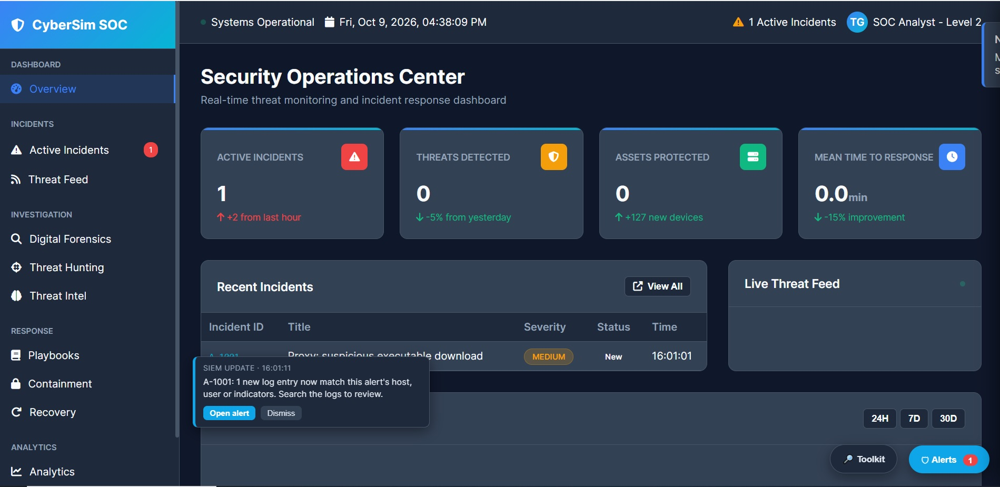
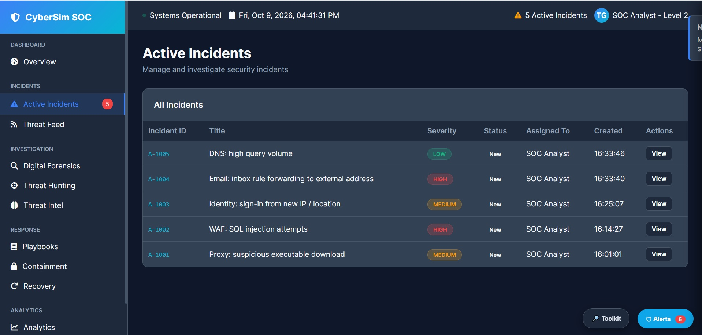
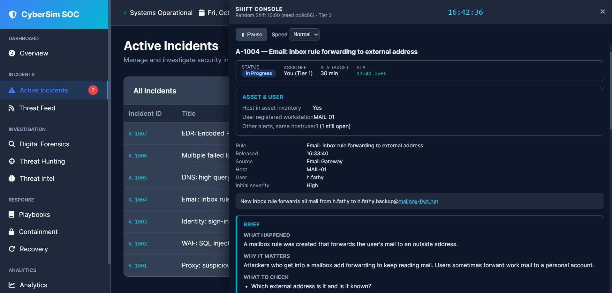

# 🛡️ CyberSim SOC Simulator Pro

**A hands-on SOC Tier 1 training and assessment platform for cybersecurity beginners.**

Practise a simulated analyst shift, investigate alerts with logs and IOC context, make evidence-based triage decisions, and review feedback to plan your next practice session. This is an educational simulation: response actions do not affect real systems, and scores are not a validated hiring or certification assessment.

## Highlights

- Two-hour simulated shift with scheduled alert releases, pause/resume, and playback speed controls.
- Alert triage with verdict, severity, escalation, SLA, and analyst notes.
- Investigation Toolkit: log search, IOC lookup, asset/user context, simulated response actions, scenario library, and report.
- Random generated shifts with optional reproducible seed; authored scenarios can be opened with `?fixed=1`.
- Model-answer review, per-category scores, findings, recommended next practice, and JSON report export.
- Persistent Beginner Hints toggle with an investigation checklist that guides learners without revealing model answers.
- Automatic checkpoints plus a **Save shift** control; resume an unfinished shift after reload from the same browser.
- A simulated response-state ledger and targeted next-practice recommendations in the shift report.
- Incident lifecycle model (New → Investigating → Contained → Resolved) with evidence-gated transitions, response verification, residual-risk checks, audit history, and case notes.
- 100 authored scenario files listed in `data/scenarios/index.json`.
- Dashboard metrics and threat feed now derive from alerts released in the active simulated shift rather than fabricated random telemetry.

## Screenshots

### SOC overview



### Active incident queue



### Alert investigation



## Quick start

Requirements: Python 3.8+ and a modern browser. No build step is required.

```bash
git clone https://github.com/osama-moussa/cybersim-soc-simulator-pro.git
cd cybersim-soc-simulator-pro
python server.py
```

Open `http://localhost:8000`. Do not open `index.html` directly from disk because scenarios are loaded with `fetch()`. The included server is for local development; do not expose it to untrusted networks.

Windows alternative: `py server.py`. Linux/macOS alternative: `python3 server.py`.

## First shift

1. Read the handover briefing and start the shift.
2. Open an alert and review its rule brief, severity, SLA, asset/user context, and related alerts.
3. Search the logs and look up relevant IOCs; correlate evidence before deciding.
4. Select True Positive or False Positive, assess severity, and escalate when appropriate.
5. Use simulated response actions only when supported by evidence; document your reasoning.
6. Use **Save shift** to checkpoint progress, or reload and choose to resume when prompted. At shift end, review the report and export it as JSON if you want to keep a copy.

## Scoring

The scoring engine evaluates triage, response actions, investigation activity, and time against SLA targets. Expected response actions are matched to related alert evidence where possible; actions taken after the response target or before the related alert are flagged in the report. Current weights and timing rules are defined in `js/scoring.js`. Scores help identify practice areas; they do not prove readiness for live SOC work.

Investigation activity is associated with the alert being reviewed where possible. Searches made before opening an alert only count when the query matches identifiers in that alert. Timing correlation is heuristic: repeated use of the same account, host, or indicator across multiple alerts may require analyst review.

### Save and resume

The app checkpoints an unfinished shift to browser `localStorage` and offers to resume it on the next load. The saved checkpoint includes the generated scenario and analyst state so the shift can be reproduced. It is local to the browser and device; clearing site data removes it. Because this is a client-side training app, scenario truth may be inspectable in browser storage and this feature is for convenience, not secure assessment integrity. Starting a different scenario discards the current checkpoint.

## Scenario library

Scenario JSON files are stored in `data/scenarios/`; `data/scenarios/index.json` registers them. Each alert should have a unique `id`, numeric `at` release minute, valid visible severity, and `truth` containing a `TP`/`FP` verdict, valid severity, and boolean escalation expectation. Validate a new scenario before merging.

URL examples:

```text
http://localhost:8000/
http://localhost:8000/?seed=training-seed-01
http://localhost:8000/?scenario=sc-001&fixed=1
```

- `?seed=...` replays a generated shift.
- `?fixed=1` loads the authored scenario without random generation.
- `?scenario=sc-001` selects a scenario identifier; the generator may still assemble a generated shift from the library unless fixed mode is enabled.

## Project structure

```text
index.html
server.py
css/
js/
  engine.js          # shift clock, alert releases, scenario validation
  state.js           # alert decisions, activity, response actions
  scoring.js         # scoring and feedback
  shiftGenerator.js  # reproducible random shift generation
  ui/                # alert queue, toolkit, playbooks, timeline, response actions
data/scenarios/      # 100 authored scenarios + index.json
tests/               # automated Node.js tests
docs/screenshots/    # screenshots of the current interface
```

## Testing

Requires Node.js 18+; no third-party test dependency is required.

```bash
node --test tests/*.test.js
```

The tests cover scenario data integrity, key scoring behaviours, response assessment, and incident lifecycle transition guards. They are a baseline, not a complete end-to-end browser test suite.

## Current limitations

- Some sidebar workspaces are explicitly marked **Coming soon**; the primary implemented workflow is the Shift Console and Toolkit.
- Shift checkpoints and completed score history are stored in browser Local Storage, not a cloud account. Clearing site data removes them.
- The dashboard represents the current simulated shift, not a live production SIEM.
- Some external icons/chart assets are CDN-hosted and need an internet connection.
- Client-side assessment data is suitable for self-practice, not tamper-resistant hiring assessments.

## Roadmap

- [x] Beginner hint panel with persistent on/off preference.
- [ ] More scenario-aware progressive hints and a dedicated guided learning curriculum.
- [x] Save/resume shift checkpoints locally.
- [ ] Persistent learner profiles and cross-device progress.
- [ ] Export reports to PDF.
- [ ] Full causal simulation that changes future telemetry based on response actions (V6 adds rule-based log-to-response correlation, but does not generate or suppress telemetry).
- [ ] Accessibility audit and Arabic UI.
- [ ] Browser end-to-end tests.

## Contributing

Contributions are welcome, especially scenario quality improvements, tests, beginner-focused playbooks, and accessibility fixes. See [CONTRIBUTING.md](CONTRIBUTING.md).

## License and credits

See [LICENSE](LICENSE). The project is a Pro fork of [TheGhostPacket/cybersim-soc-simulator](https://github.com/TheGhostPacket/cybersim-soc-simulator). MITRE ATT&CK is referenced for educational mapping; this project is not affiliated with or endorsed by MITRE.


## V7 incident lifecycle model

`js/incidentLifecycle.js` provides a pure state model for per-alert incident records. It requires evidence before investigation, a verified action before containment, and documented evidence plus explicit outcome confirmation before resolution. A caller must not mark an incident contained/resolved while residual risk remains. The model is included as a reusable API; it does not connect to real security tools, and its simulated verification evidence is not proof of real-world containment. Use `IncidentLifecycle.get(window.shiftState, alertId, alert)` to create/read a case, `addEvidence`, `recordAction`, `verifyAction`, `transition`, `addNote`, and `summary` to operate on it.
